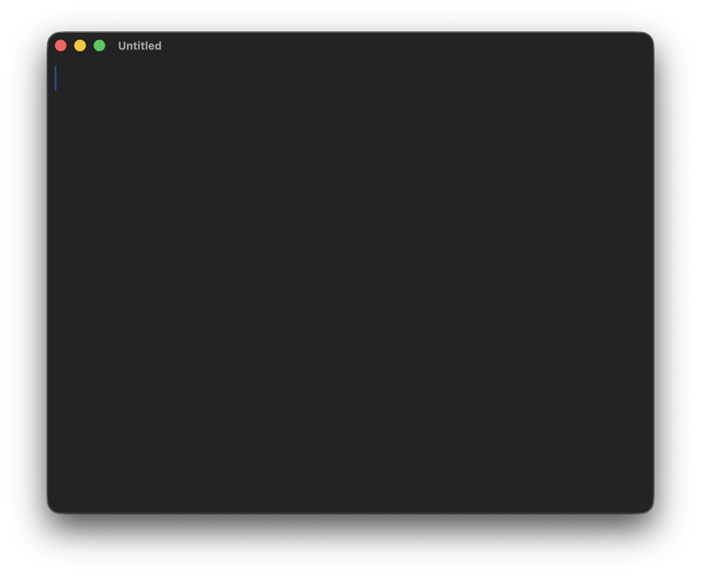

#  TextEd

The goal of TextEd is to give you a GUI text editor in macOS as fast as
theoretically possible.



## Build

```sh
make          # build TextEd.app
make run      # build and open it
```

Requires macOS 12+ and a Swift toolchain.

## Credits

TextEd is a Swift rewrite of Jeena Paradies's 2014
[TextEd.app](https://git.jeena.net/jeena/TextEd.app). The app icon artwork
comes from the original and is used under the
[MIT License](Resources/Icon-LICENSE).

## License

Copyright © 2026 John Cornell

TextEd is free software: you can redistribute it and/or modify it under the
terms of the GNU General Public License as published by the Free Software
Foundation, either version 3 of the License, or (at your option) any later
version. See [LICENSE](LICENSE).

The icon remains under its MIT License.
